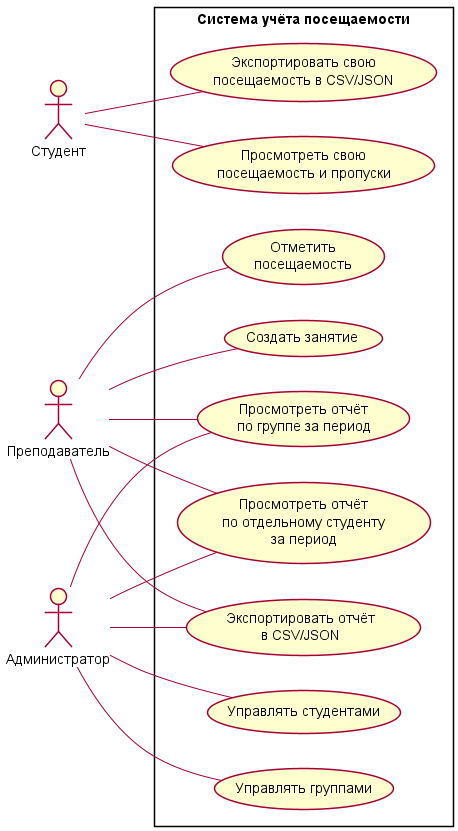
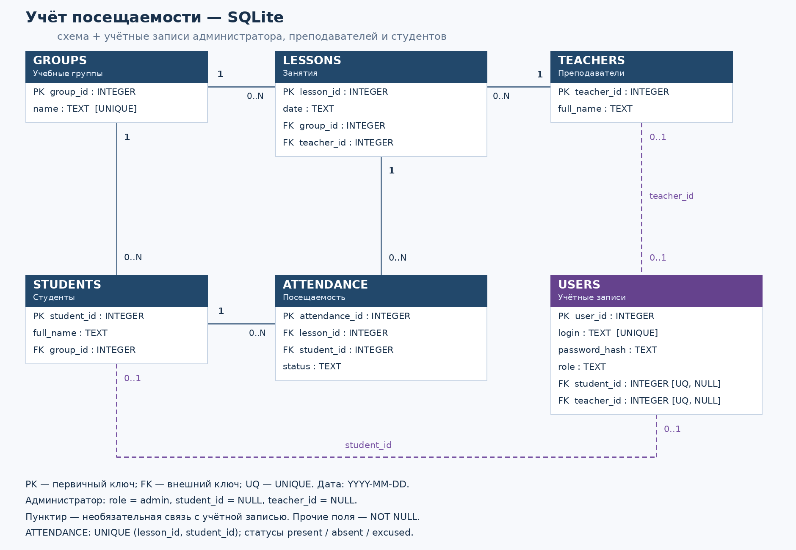

# Система учёта посещаемости студентов

Учебный проект по дисциплине «Информатика».

Автор: Царёв П. В.  
Группа: 26-ИВТ-4-1.

## Описание проекта

Проект посвящён системе учёта посещаемости занятий студентами.

В лабораторной работе №1 определены предметная область,
цели системы, её пользователи и основные функции.
Построены Use Case диаграмма и блок-схемы процессов.

В лабораторной работе №2 подготовлена структура проекта,
добавлена программа на Python и оформлена документация.
Для хранения истории изменений используется Git,
репозиторий размещается на GitHub.

## Текущая реализация

Программа выводит:

- приветствие «Hello, World!»;
- название проекта;
- информацию о лабораторной работе;
- сообщение об успешном запуске.

Функции учёта посещаемости, работа с базой данных
и экспорт отчётов пока являются планируемыми возможностями.

## Предметная область

Система предназначена для учёта посещаемости занятий студентами.

В системе предполагается хранить информацию о:

- студентах;
- учебных группах;
- занятиях;
- фактах присутствия и отсутствия студентов.

Для посещаемости предусмотрены статусы:
«присутствовал», «отсутствовал»,
«уважительная причина».

## Цели системы

1. Автоматизировать отметку посещаемости.
2. Обеспечить хранение и быстрый доступ к данным.
3. Позволить студентам отслеживать свою посещаемость.
4. Формировать отчёты по группе и отдельному студенту за период.
5. Снизить количество ошибок по сравнению с бумажным учётом.

## Пользователи системы

| Пользователь | Планируемые возможности |
|---|---|
| Преподаватель | Создание занятий, отметка посещаемости, просмотр отчётов по своей группе и отдельным студентам, экспорт отчётов |
| Студент | Просмотр и экспорт только собственной посещаемости |
| Администратор | Управление студентами и группами, просмотр и экспорт отчётов по группам и отдельным студентам |

## Планируемые функции

- Добавление и редактирование студентов.
- Добавление и редактирование групп.
- Создание занятия с указанием даты, группы и преподавателя.
- Отметка посещаемости.
- Просмотр студентом своей посещаемости с фильтрацией по дате.
- Формирование отчёта по группе за выбранный период.
- Формирование отчёта по отдельному студенту за выбранный период.
- Экспорт отчётов в CSV или JSON.

## Планируемая архитектура

Для дальнейшей реализации выбрана трёхуровневая архитектура.

| Уровень | Назначение |
|---|---|
| Представление | Консольный интерфейс для пользователя |
| Бизнес-логика | Проверка прав доступа, проверка данных, формирование отчётов |
| Доступ к данным | Хранение данных в SQLite и работа через репозитории |

## Технологии

- Python — язык программирования.
- PyCharm — среда разработки.
- Git — система контроля версий.
- GitHub — размещение репозитория.
- Markdown — оформление документации.
- PlantUML — построение диаграмм.
- SQLite — планируемая база данных.
- CSV и JSON — планируемые форматы экспорта.

## Запуск программы

Для запуска требуется Python 3.
Сторонние библиотеки не нужны.

### Запуск в PyCharm

1. Открыть проект.
2. Выбрать интерпретатор Python.
3. Открыть src/main.py.
4. Нажать правой кнопкой внутри файла.
5. Выбрать Run 'main'.

### Запуск в терминале

Из корневой папки проекта выполнить:

python src/main.py

### Результат запуска

Hello, World!
Система учёта посещаемости студентов
Учебный проект для лабораторной работы №2
Программа успешно запущена.

## Структура проекта

Программный код находится в папке src, база данных — в data,
а диаграммы — в diagrams. SQL-файлы создания и заполнения базы
расположены в корне проекта.

| Путь | Назначение |
|---|---|
| src/main.py | Основной файл программы. Запускает создание и заполнение базы данных, затем выводит результаты проверки |
| src/database_sqlite.py | Подключается к SQLite и включает проверку связей между таблицами |
| src/init_sqlite.py | Выполняет SQL-скрипты создания и заполнения таблиц, добавляет тестовые учётные записи пользователей |
| src/check_sqlite.py | Выводит количество записей, пользователей и посещаемость, проверяет целостность связей |
| src/test1.py | Учебная заготовка из предыдущей лабораторной работы |
| schema_sqlite.sql | Содержит команды создания таблиц, первичных и внешних ключей, ограничений данных |
| seed_sqlite.sql | Содержит команды добавления тестовых групп, преподавателей, студентов, занятий и отметок посещаемости |
| data/attendance_lab3.db | Файл базы данных SQLite. Создаётся автоматически при первом запуске программы |
| diagrams/use_case.puml | Исходный текст диаграммы вариантов использования: действия преподавателя, студента и администратора |
| diagrams/use_case.png | Изображение диаграммы вариантов использования |
| diagrams/er_sqlite_users.puml | Исходный текст ER-диаграммы: таблицы, поля, типы данных, ключи и связи |
| diagrams/er_sqlite_users.png | Изображение ER-диаграммы базы данных |
| diagrams/er_sqlite_users.svg | ER-диаграмма в векторном формате для масштабирования без потери качества |
| docs/test1.txt | Заготовка текстового документа для заметок по проекту |
| README.md | Описание проекта, его возможностей, структуры, диаграмм и порядка запуска |
| .gitignore | Правила исключения служебных файлов и виртуального окружения из Git |
| venv/ | Локальное виртуальное окружение Python с интерпретатором и установленными библиотеками. В Git не добавляется |

## Use Case диаграмма

Диаграмма отражает планируемые возможности системы
и взаимодействие её пользователей.



[Исходный текст диаграммы](diagrams/use_case.puml)

## Полезные ссылки

- [Python](https://www.python.org/)
- [Git](https://git-scm.com/)
- [GitHub](https://github.com/)
- [PlantUML](https://plantuml.com/)ы. Выбрана трёхуровневая архитектура и технологии реализации. Построены Use Case диаграмма и две блок-схемы основных процессов.

## Лабораторная работа №3 — база данных SQLite

Подготовлена база данных системы учёта посещаемости занятий студентами.
Приложение работает на Python; SQLite вызывается стандартным модулем sqlite3.

### ER-диаграмма



[Исходник PlantUML](diagrams/er_sqlite_users.puml) · [SVG](diagrams/er_sqlite_users.svg)

### Таблицы

| Таблица | Назначение | Первичный ключ | Внешние ключи |
|---|---|---|---|
| groups | Учебные группы | group_id | — |
| teachers | Преподаватели | teacher_id | — |
| students | Студенты и их группы | student_id | group_id → groups |
| lessons | Дата, группа и преподаватель занятия | lesson_id | group_id → groups; teacher_id → teachers |
| attendance | Отметки посещаемости | attendance_id | lesson_id → lessons; student_id → students |
| users | Учётные записи и роли | user_id | student_id → students; teacher_id → teachers |

Идентификаторы имеют тип INTEGER, остальные поля — TEXT.
Дата хранится в формате YYYY-MM-DD.
Типы атрибутов, PK/FK и кратности связей показаны на диаграмме.

Группа связана со студентами и занятиями отношением 1:N, преподаватель
с занятиями — 1:N. Связь студентов и занятий M:N реализована через attendance.
Студент и преподаватель могут иметь по одной учётной записи: связь с users
необязательная 1:1, то есть 0..1 с обеих сторон. UNIQUE запрещает несколько
учётных записей для одного и того же студента или преподавателя.

Роли пользователей: admin, teacher, student. Администратор хранится в users
с role = 'admin', student_id = NULL и teacher_id = NULL.
Для преподавателя заполнен только teacher_id, для студента — только student_id.
Согласованность роли и ссылки проверяется ограничением CHECK.
Полномочия ролей будут проверяться в коде приложения при реализации входа.

Ограничение UNIQUE (lesson_id, student_id) исключает повторную отметку.
Статусы ограничены CHECK: present, absent, excused.
Отсутствие строки attendance означает, что отметка ещё не внесена.
Прямые SQL-вставки не проверяют совпадение группы студента и занятия:
эта бизнес-проверка потребуется при реализации отметки посещаемости.

### Реализация

- schema_sqlite.sql — CREATE TABLE и ограничения.
- seed_sqlite.sql — INSERT INTO с учебными группами, студентами, преподавателями,
  занятиями и отметками.
- src/database_sqlite.py — открытие файла БД и включение внешних ключей.
- src/init_sqlite.py — выполнение SQL-скриптов и INSERT INTO с учётными записями.
- src/check_sqlite.py — проверка таблиц, ролей, связей и выборки посещаемости.
- src/main.py — общий запуск практической части.

### Запуск

В PyCharm запустить src/main.py через Run 'main'. Из корня проекта:

```bash
python src/main.py
```

Создаётся файл data/attendance_lab3.db. Повторный запуск сохраняет
существующие записи и не дублирует тестовые данные.
Данные вымышленные. В каждой таблице несколько записей:

```text
groups: 2
teachers: 2
students: 4
lessons: 4
attendance: 8
users: 7
```

Для users сохраняются хеши учебного пароля Demo123!.
Этот пароль используется только для заполнения учебных учётных записей.

### Проверка

В выводе программы должно быть:

```text
Проверка внешних ключей включена: 1
Нарушения внешних ключей: []
```

Проверены создание базы, повторный запуск, сохранение исправленных отметок,
запрет несуществующих ссылок, повторных отметок, некорректной привязки роли
и нескольких учётных записей для одного студента.
